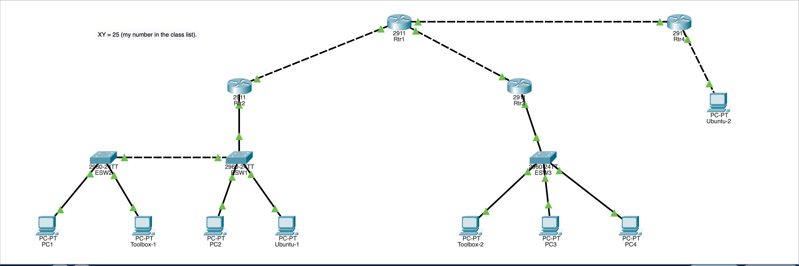

# Multi-area OSPF network with DHCP and SSH

[Back to the portfolio](../../)

## Objective

Build the network given by the lecturer in WQE7001, with my number XY = 25 in the addresses. The routers must share their routes with OSPF, give addresses to the PCs with DHCP for IPv4 and IPv6, and the core router must accept remote login with SSH only.

## Environment and tools

- Cisco Packet Tracer, 4 routers (2911), 3 switches (2960) and 8 end devices.
- Rtr1 is the core router. It connects to Rtr4 in OSPF area 0 (10.10.100.0/24) and to Rtr2 and Rtr3 in OSPF area 25 (10.10.25.0/30 and 10.10.25.4/30).
- Rtr2 is the DHCP server for VLAN 10 (192.168.125.0/24) and VLAN 20 (192.168.225.0/24), with router-on-a-stick sub-interfaces.
- Rtr3 is the DHCP server for the LAN 172.16.25.0/24.
- Each LAN also has an IPv6 /64 prefix, with OSPFv3 and DHCPv6.



## Method

1. Address plan : I replaced XY by 25 everywhere in the diagram of the lecturer, for IPv4 and IPv6.
2. Basic settings on each router : hostname, a local user, enable secret, no ip domain-lookup.
3. OSPFv2 with a router ID per router (1.1.1.25, 2.2.2.25...), the Rtr1 to Rtr4 link in area 0 and the rest in area 25. Rtr1 is the area border router.
4. OSPFv3 for IPv6, with the same areas. I used fixed link-local addresses (fe80::1, fe80::2...) so the neighbours are easy to read.
5. VLAN 10 and 20 on the switches, a trunk to Rtr2 and sub-interfaces g0/1.10 and g0/1.20 with dot1Q.
6. DHCPv4 pools on Rtr2 and Rtr3, with the first 10 addresses excluded for the gateways and servers.
7. DHCPv6 pools, and ipv6 nd managed-config-flag on the LAN interfaces, so the PCs ask the DHCPv6 server for an address.
8. SSH on Rtr1 : domain name, RSA key, ip ssh version 2, and transport input ssh on the vty lines, so Telnet is refused.

I don't publish the full configurations here, because the lecturer will test this network remotely in week 9. Below is only the SSH part, which is common to every student :

```
ip domain-name wqe7001.lab
crypto key generate rsa
ip ssh version 2
line vty 0 4
 login local
 transport input ssh
```

## Results

- OSPF and OSPFv3 neighbours in FULL state in area 0 and area 25.
- The PCs get an IPv4 and an IPv6 address from Rtr2 and Rtr3 (checked with show ip dhcp binding).
- Ping in IPv4 and IPv6 from PC1 (VLAN 10, behind Rtr2) to PC3 (behind Rtr3) works.
- SSH to Rtr1 on 10.10.100.25 works, Telnet is refused.

## What I would do differently

- The addresses of Rtr4 and Ubuntu-2 are not on the diagram of the lecturer, so I used temporary values. I will check them before the remote test in week 9.
- Add OSPF authentication between the routers, so a fake router cannot join the area and inject routes.
- Make the LAN interfaces passive in OSPF, so no OSPF hello is sent to the PCs.
- Use a longer RSA key (2048 bits instead of 1024) and limit SSH access to the vty lines with an ACL.
- Rebuild the same network in GNS3 with real IOS images, because the remote test of the lecturer will probably be on GNS3.
