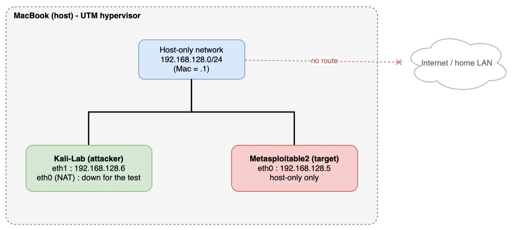
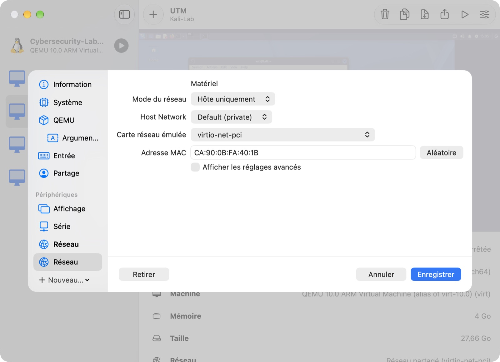
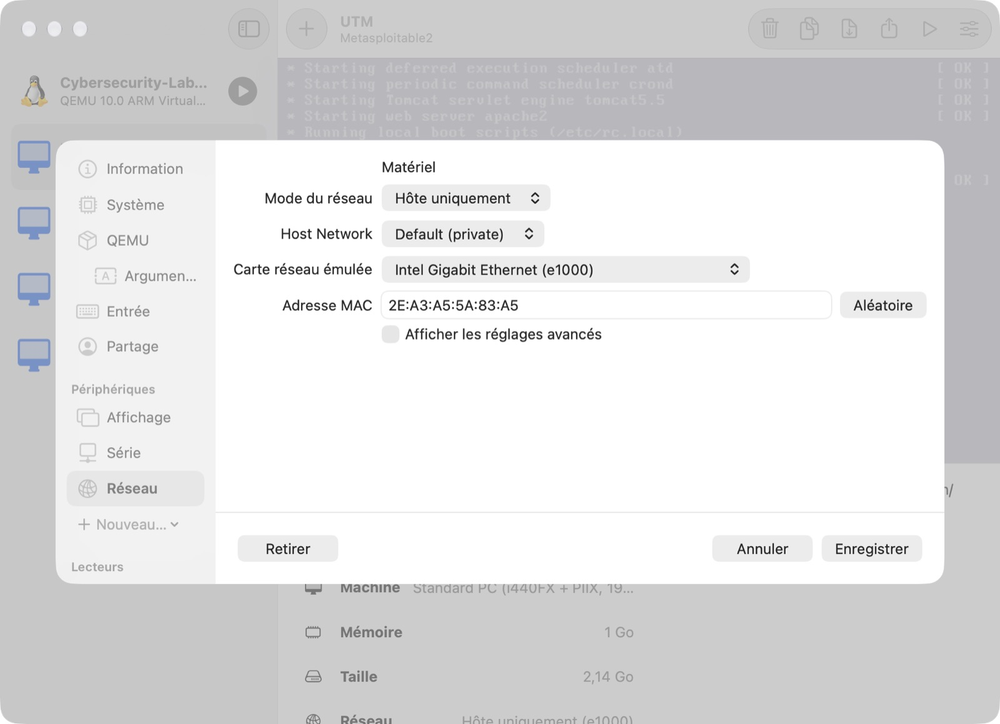
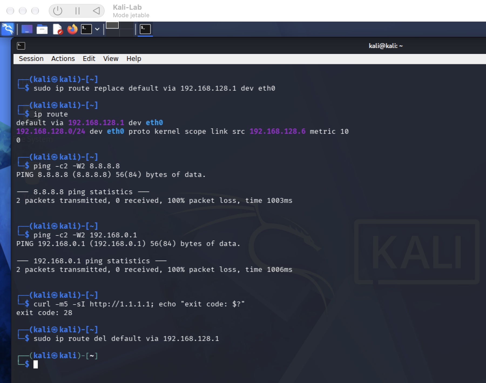
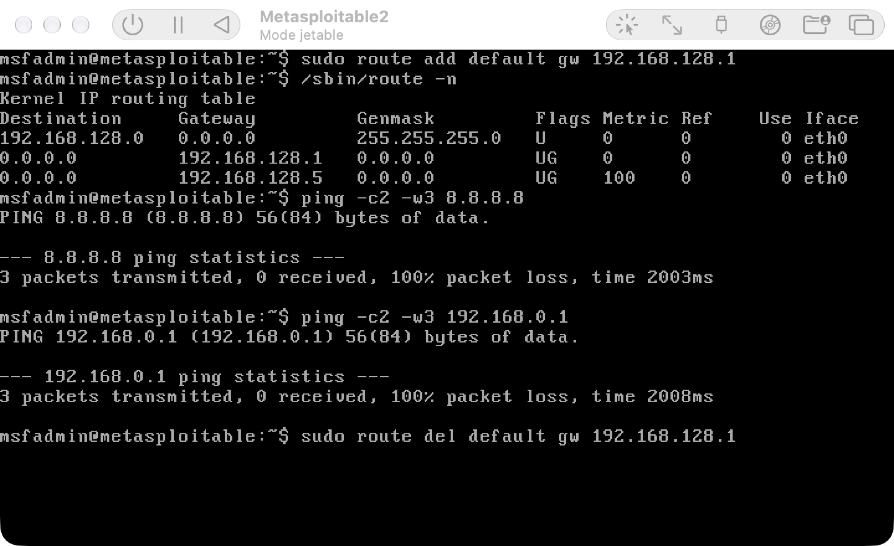
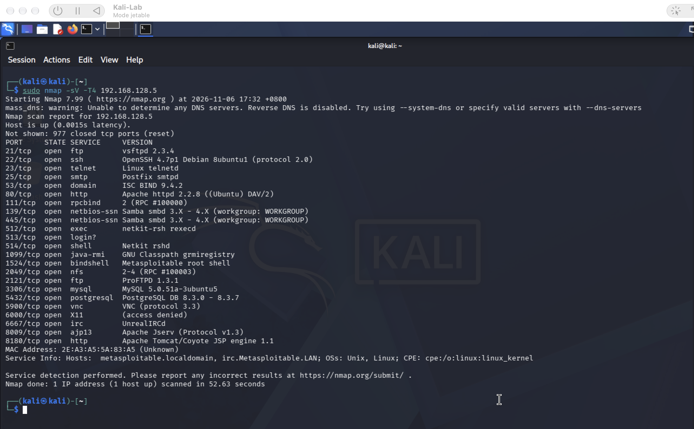
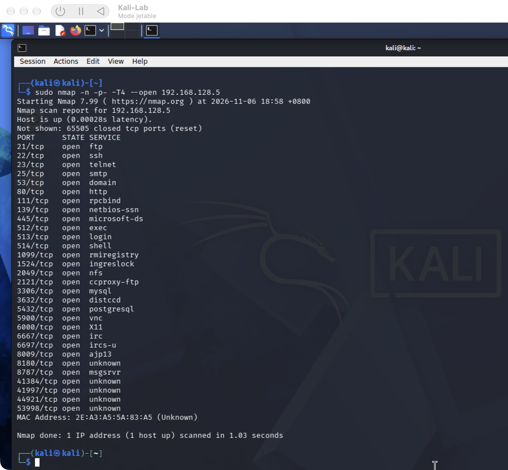
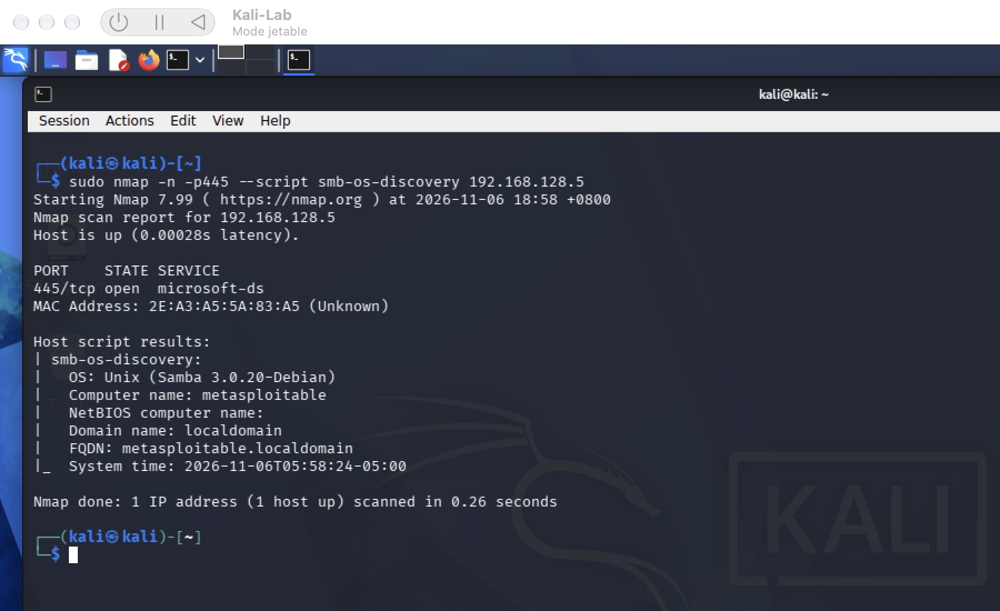

# Isolated virtual lab and Nmap service scan

[Back to the portfolio](../../)

## Objective

Build a small lab with an attacker machine and a vulnerable target. Prove that the lab is isolated from the Internet and from my home network. Then scan the target and explain what the open services mean for a defender.

## Environment and tools

- Host : MacBook with an Apple M5 chip. The Cisco VMs are made for x86, so I used UTM, a hypervisor based on QEMU who can also emulate x86.
- Kali-Lab (attacker) : Kali Linux ARM64, 4 GB RAM, 2 CPU, one network card in host-only mode.
- Metasploitable2 (target) : i386 emulated, 1 GB RAM, 1 CPU, one network card in host-only mode.
- Network : UTM host-only network 192.168.128.0/24, the Mac is .1, Metasploitable2 is .5 and Kali is .6.
- Tools : ip, route, ping, curl, Nmap 7.99.
- Both VMs started in disposable mode, so nothing is written on the disk after the tests.

Lab diagram (first version, when Kali still had a second card for updates) :

## Method

1. Network settings in UTM : I removed the shared (NAT) card of Kali, so both VMs have only one card in host-only mode.

   

   

2. Isolation check on both VMs : ip -br a and route -n, then ping 8.8.8.8. Both fail with 100 % packet loss.
3. Worst case test : I added by hand a default route through the Mac (192.168.128.1) on both VMs. Even then, 8.8.8.8, my home router and curl to 1.1.1.1 fail. So the Mac does not route the lab traffic. After the test I deleted the route.

   

   

4. Kali and Metasploitable2 ping each other, 3 packets out of 3 in both directions.
5. Service scan from Kali : sudo nmap -sV -T4 192.168.128.5 (06.11.2026).
6. Full port scan : sudo nmap -p- 192.168.128.5, to see the ports outside the top 1,000.
7. Samba version check : nmap -n -p445 --script smb-os-discovery 192.168.128.5, because -sV only showed "3.X - 4.X".

## Results

Nmap found 23 open TCP ports in the top 1,000, and 30 with the full scan.

What the main ports mean :

- 21 FTP (vsftpd 2.3.4) : clear text, and this version has a known backdoor (CVE-2011-2523).
- 22 SSH (OpenSSH 4.7) : encrypted but very old, weak passwords can be brute forced.
- 23 Telnet : remote admin in clear text, passwords can be sniffed.
- 139 and 445 Samba 3.0.20 : the usermap_script flaw CVE-2007-2447 gives remote command execution.
- 512 to 514 rexec, rlogin, rsh : old remote commands without encryption.
- 1524 bindshell : connecting to it gives a root shell directly.
- 3306 and 5432 MySQL and PostgreSQL : databases open on the network.
- 8180 Tomcat : the manager often has default logins and lets you upload a web shell.

My interpretation : a normal Linux server exposes 2 or 3 services. Here there are 30, many in clear text and many with versions from 2008. The full scan also found services like distccd on port 3632 that the top 1,000 scan missed.

## What I would do differently

- Remove the NAT card from the start. In my first version I only put it down inside Kali, and one command can put it up again (see the [learning journey](../../#learning-journey)).
- Always run a full -p- scan in a real assessment, a top 1,000 scan is not enough.
- Check the versions with a second method, because -sV only reads the banners.
- To fix the target : close every service not needed, replace Telnet, rsh and FTP by SSH and SFTP, update Samba, vsftpd and the databases. Port 1524 is the most urgent because it gives root without any exploit.
- Next step : add a Wazuh or Security Onion sensor to the lab, to see the same scan from the defender side.
